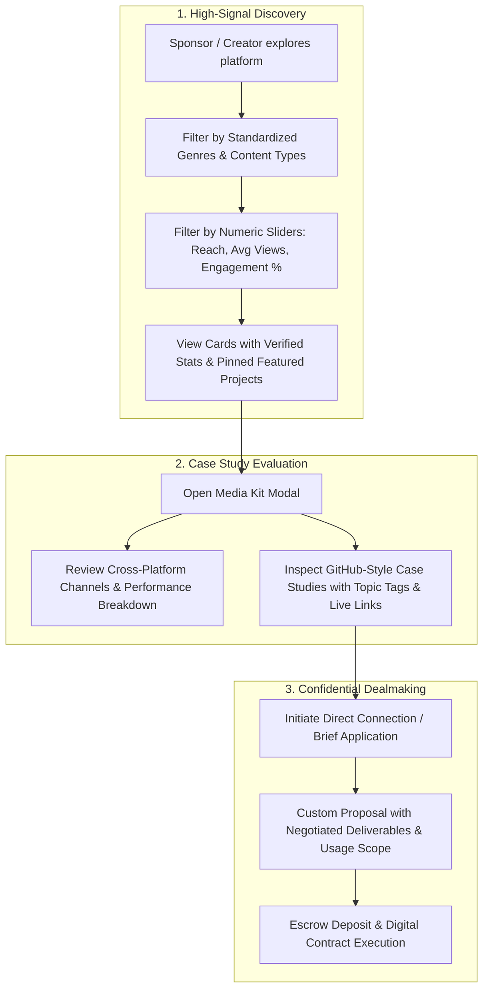

# UX Evolution & Design Decisions Document: CollabNet 2.0

## 1. Executive Summary & Design Philosophy

CollabNet 2.0 evolved from an early-stage prototype with informal conventions (gamified badges, canned dropdowns, isolated boilerplate templates, and public price tags) into a **serious, high-signal B2B platform for creator sponsorships and brand partnerships**.

Professional influencer and creator partnerships resemble B2B talent procurement and agency contracting rather than casual gig marketplaces. The design decisions summarized below were made to eliminate cognitive noise, protect negotiation leverage for both parties, and provide deep, verifiable signal on content quality and quantitative performance.

---

## 2. Core UX Decisions & Strategic Rationale

### Decision 1: Elimination of Gamification Badges in Favor of Verifiable Stats
* **Previous Approach**: Displayed gamified badges and status ranks (e.g. *"Rising Star"*, *"Elite Dealmaker"*, points-based badges).
* **The UX Problem**: Professional marketing directors and enterprise brand managers found gamified badges trivial and uninformative for allocating real marketing budgets. They wanted hard, audited performance numbers.
* **The Decision**: Completely eliminated the badge/gamification system.
* **New UX**: Replaced badges with a multi-channel **Performance Matrix**:
  * Total Cross-Platform Reach (e.g., `970K`)
  * Median / Average Views per Deliverable (e.g., `240K avg`)
  * Engagement Rate % (e.g., `4.8%`)
  * Verified Deal History & Platform Connections count.

---

### Decision 2: Standardized Preset Genres & Deliverable Formats
* **Previous Approach**: Freeform text inputs for niches, genres, and deliverables.
* **The UX Problem**: Freeform text created fragmented search results (e.g., *"tech"*, *"technology"*, *"gadgets"*, *"consumer tech"*), making discovery inconsistent and frustrating.
* **The Decision**: Established standardized taxonomies across creator onboarding, profile editing, and search discovery.
* **New UX**:
  * **9 Standardized Primary Genres**: Tech & Gadgets, Beauty & Skincare, Health & Fitness, Food & Cooking, Gaming, Travel, Finance & Business, Lifestyle, Wellness.
  * **Visual Color Identifiers (`GENRE_COLORS`)**: GitHub language-dot inspired color coding for instant visual differentiation across cards and media kits.
  * **Standard Deliverable Formats**: Dedicated Long-Form Video, Integrated Segment, Short-Form Video, Live Stream Placement, Podcast Episode / Audio Read, Carousel / Thought Leadership, UGC Ad Production.

---

### Decision 3: Precision Range Sliders over Freeform Numeric Inputs
* **Previous Approach**: Raw, unconstrained text boxes for minimum and maximum follower/view inputs.
* **The UX Problem**: Required typing arbitrary numbers without knowing the active dataset distribution, leading to frequent zero-result queries.
* **The Decision**: Implemented Radix UI precision sliders with predefined step intervals and min/max boundaries.
* **New UX**:
  * Responsive sliders for **Followers Range** (`0` to `2.5M+`), **Min Average Views** (`0` to `500K+`), and **Min Engagement Rate** (`0%` to `10%+`).
  * Real-time counter feedback and visual track scrubbing without page reloads.

---

### Decision 4: GitHub-Style Project Repositories & Topic Tags
* **Previous Approach**: Basic, unstructured bio text with no case study evidence.
* **The UX Problem**: Sponsors couldn't evaluate content aesthetic, storytelling tone, or real brand integration quality before initiating outreach.
* **The Decision**: Architected a GitHub repository-style portfolio showcase on creator profiles.
* **New UX**:
  * **Standardized Project Metadata**:
    * Project Title & Bio/Description
    * Primary Genre with color indicator
    * Multiple Sub-Niche / Topic Tags (e.g., `#Smart Home`, `#Ergonomics`, `#Hardware`)
    * Brand Partner attribution (e.g., *"Autonomous AI"*, *"Nike Running"*)
    * Pinned Project toggle (`pinned: true`) featured at the top of discovery cards
    * Live demo link and rich thumbnail/embed media
  * **Discovery Filtering**: Sponsors can filter portfolio items within the Media Kit dialog by topic tags and live search.

---

### Decision 5: Clean Removal of Generic "Commercial Terms" Filter
* **Previous Approach**: An "All Terms" dropdown with canned filter chips (*"100% Escrow Upfront"*, *"1-Round Revision Guarantee"*, *"30-Day Paid Whitelisting Available"*, *"Organic Posting Only"*).
* **The UX Problem**: Commercial terms in brand partnerships are inherently bespoke. Factors such as exclusivity duration, whitelisting ad spend rights, licensing territory, revision cycles, and milestone payouts vary per deal. Attempting to generalize them into high-level search filters caused false negatives and didn't reflect industry negotiation norms.
* **The Decision**: Cleanly removed the commercial terms dropdown and filter chips from discovery.
* **New UX**: Commercial terms are defined and negotiated directly within the bilateral contract drafting and proposal workflow, where customized clauses belong.

---

### Decision 6: Confidential Financials (Removal of Public Rate Sliders & Public Budgets)
* **Previous Approach**: Displayed starting rates on creator cards (*"from $800/post"*), a *"Max Rate"* filter slider, and public dollar budget ranges on open campaigns (*"$4,000 – $12,000"*).
* **The UX Problem**:
  * Creators dislike publishing fixed public rates because pricing scales dynamically based on licensing scope, exclusivity restrictions, whitelisting duration, and content complexity. A public starting price anchors them unfairly.
  * Sponsors dislike broadcasting fixed public budget ceilings because it prevents competitive bidding and distorts market rates.
* **The Decision**: Cleanly removed all public cost sliders, dollar rate tags, and budget input filters.
* **New UX**:
  * Campaign cards display a professional status pill: **`Paid Campaign · Negotiable`**.
  * Creator cards display **`Custom Deal Proposal`** and direct sponsors to request a tailored quote via the Media Kit.
  * In Account settings, baseline rates are preserved as **private defaults** for drafting proposals, never exposed on public discovery surfaces.

---

### Decision 7: Complete Removal of the Disconnected "Templates" System
* **Previous Approach**: A standalone "Templates" card on the Account settings page with an empty state (*"No templates yet."*, *"New template"*) for generic briefs, outreach messages, and agreement snippets.
* **The UX Problem**:
  * The templates box was disconnected from actual workflows. Users do not draft outreach or briefs in an isolated settings tab.
  * Sponsors create briefs inside the Campaign creation wizard.
  * Creators and sponsors customize outreach inside direct messaging and deal proposal dialogs.
  * Contract agreements are handled via the interactive legal contract editor with signature pads.
  * Having an empty, out-of-context "Templates" panel cluttered the profile page and confused new users.
* **The Decision**: Completely and cleanly removed the template system from both frontend (`Account.jsx`) and backend (`server.py`).
* **New UX**: Profile settings now focus entirely on high-value essentials: verified credentials, social channels portfolio, baseline proposal rates, and GitHub-style project repositories.

---

## 3. Before vs. After UX Comparison Matrix

| Feature Dimension | Early Prototype (Before) | CollabNet 2.0 (After) | UX Rationale |
| :--- | :--- | :--- | :--- |
| **Trust & Verification** | Gamified badges & points ranks | Audited stats matrix (Reach, Avg Views, Engagement %, Connections) | B2B decision-makers need quantitative evidence, not arcade badges. |
| **Niche Classification** | Freeform text fields | 9 standardized preset genres with color dots (`GENRE_COLORS`) | Eliminates spelling discrepancies and standardizes search indexing. |
| **Numeric Filtering** | Unbounded text boxes (`min`/`max`) | Responsive Radix UI sliders with dynamic bounds and step ticks | Eliminates zero-result guesses; gives instant tactile feedback. |
| **Portfolio Showcase** | Plain bio text | GitHub-style repositories with title, bio, topic tags, brand, and pinned status | Enables sponsors to inspect real case studies and production caliber. |
| **Commercial Terms** | "All Terms" dropdown with canned chips | Bespoke bilateral contract terms during proposal & negotiation | Partnership terms are deal-specific; canned presets caused false filters. |
| **Pricing & Budgets** | Public dollar tags (`from $800`, `$4k-$12k`) | `Paid Campaign · Negotiable` & `Custom Deal Proposal` | Protects creator pricing power and sponsor budget confidentiality. |
| **Templates Management** | Disconnected "Templates" card on Account page | Native in-context creation (Campaign wizard, Chat, Contract pad) | Removes out-of-context clutter from profile settings. |

---

## 4. End-to-End User Flow Architecture

---

## 5. Verification & Test Suite Integrity

All test suites were updated and validated across both frontend and backend:
* **Frontend Test Suites**: 8 / 8 passed (36 / 36 tests clean).
* **Backend Test Suite**: 20 / 20 pytest items passed.
* **Build Status**: Webpack compiled successfully with zero compile warnings or missing imports.
